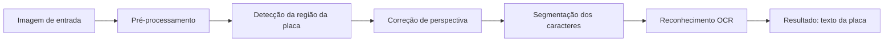
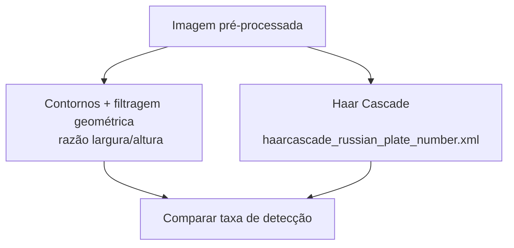
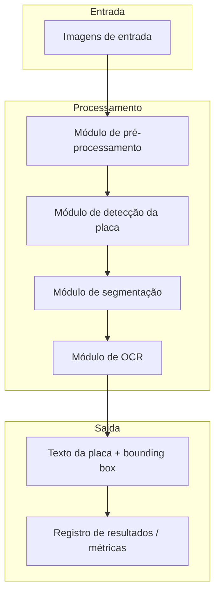

# Proposta — Detecção e Reconhecimento de Placas Veiculares (ALPR)

## 1. Problema

O problema investigado é a **localização automática da região da placa em uma
imagem de veículo e o reconhecimento dos caracteres nela contidos**.

- **Situação inicial:** uma imagem (foto ou frame de vídeo) contendo um veículo,
  capturada em ângulo e distância variáveis, com uma placa veicular visível.
- **Informação a ser produzida:** a região da imagem correspondente à placa
  (bounding box) e o texto reconhecido dos caracteres (ex: `ABC1D23`).
- **Por que envolve PDI:** a tarefa exige realce de bordas para diferenciar a
  placa do restante da carroceria, segmentação da região retangular da placa,
  correção de perspectiva (a placa raramente está perfeitamente frontal) e
  segmentação individual de cada caractere antes do reconhecimento.

Especificamente, o sistema deverá **detectar a posição da placa**, **corrigir sua
perspectiva** e **segmentar/reconhecer os caracteres alfanuméricos** — não se trata
apenas de "usar IA para reconhecer imagens" de forma genérica.

## 2. Contexto de aplicação

Sistemas ALPR são utilizados em controle de acesso a estacionamentos, pedágios,
fiscalização de trânsito e monitoramento urbano. Este projeto não pretende ser um
produto comercial, mas uma versão simplificada com contexto suficientemente concreto
para avaliar os resultados: dado um conjunto de imagens de teste, é possível medir
quantas placas foram corretamente localizadas e quantos caracteres foram
corretamente reconhecidos.

## 3. Objetivo

**Objetivo geral:** desenvolver um pipeline de processamento de imagens capaz de
localizar a placa de um veículo em uma fotografia e extrair o texto correspondente.

**Objetivos específicos:**

1. Implementar pré-processamento (escala de cinza, equalização de histograma,
   redução de ruído).
2. Detectar a região da placa, comparando ao menos duas abordagens (contornos +
   filtragem geométrica vs. Haar Cascade pré-treinada).
3. Corrigir a perspectiva da região detectada (*warp*).
4. Segmentar os caracteres individuais da placa.
5. Reconhecer os caracteres segmentados (OCR) e medir a taxa de acerto em um
   conjunto de teste.

## 4. Entrada e saída esperadas

```text
imagem do veículo
   ↓
pré-processamento (grayscale, blur, equalização)
   ↓
detecção da região da placa (contornos / Haar Cascade)
   ↓
correção de perspectiva
   ↓
segmentação dos caracteres
   ↓
reconhecimento (OCR)
   ↓
texto da placa
```

- **Entrada:** imagem estática (JPG/PNG) contendo um veículo com placa visível.
- **Saída:** bounding box da placa + string de texto reconhecida.
- **Decisão/informação produzida:** confirmação da localização da placa e seu
  conteúdo textual, permitindo posteriormente comparação com um valor esperado
  (ground truth) para cálculo de acurácia.

## 5. Imagens e dados

- **Origem:** dataset público "Car Plate Detection" (Kaggle), contendo imagens
  anotadas com bounding boxes em XML (formato Pascal VOC).
- **Complementação:** fotos próprias de veículos com placas no padrão Mercosul
  (fonte e layout diferentes do padrão antigo), para cobrir o padrão atual
  utilizado no Brasil.
- **Quantidade inicial:** o dataset público possui centenas de imagens anotadas;
  para a M1, um subconjunto de ~30–50 imagens será usado para os experimentos
  exploratórios iniciais.
- **Formatos/resolução:** imagens JPG/PNG, resoluções variadas — será avaliada a
  necessidade de padronização (resize) no pré-processamento.
- **Restrições de uso:** dataset do Kaggle sob licença de uso acadêmico/pesquisa;
  fotos próprias serão de veículos dos próprios integrantes do grupo, evitando
  problemas de imagem de terceiros sem consentimento.
- **Distribuição no repositório:** por conter placas reais (dados potencialmente
  sensíveis), avaliaremos se as imagens serão versionadas diretamente ou se apenas
  instruções de obtenção serão fornecidas, mantendo no repositório apenas exemplos
  ilustrativos ou anonimizados.

## 6. Pipeline preliminar



Alternativas consideradas para a etapa de detecção:



| Etapa | Finalidade | Técnica considerada | Entrada | Saída | Dúvidas em aberto |
|---|---|---|---|---|---|
| Pré-processamento | Reduzir ruído e realçar bordas | Grayscale, blur gaussiano, equalização de histograma | Imagem RGB | Imagem tratada em escala de cinza | Qual nível de blur preserva bordas da placa sem perder detalhe |
| Detecção da placa | Localizar a região retangular da placa | Contornos + filtro por proporção; Haar Cascade | Imagem tratada | Bounding box da placa | Qual método generaliza melhor entre ângulos/distâncias |
| Correção de perspectiva | Alinhar a placa frontalmente | Transformação de perspectiva (warpPerspective) | Bounding box + 4 cantos | Imagem retificada da placa | Como detectar os 4 cantos de forma robusta |
| Segmentação de caracteres | Isolar cada caractere | Threshold + contornos | Placa retificada | Conjunto de sub-imagens (caracteres) | Como lidar com caracteres colados ou parafuso/moldura no meio |
| Reconhecimento (OCR) | Converter caractere em texto | Tesseract OCR | Sub-imagens de caracteres | Texto da placa | Precisão do Tesseract em fontes de placa (padrão Mercosul) |

## 7. Arquitetura preliminar



A solução será organizada em módulos separados em C++ (um por etapa do pipeline),
permitindo testar e comparar abordagens alternativas (ex: trocar o método de
detecção) sem alterar as demais etapas.

## 8. Estudo inicial de viabilidade

- Inspeção manual de amostras do dataset "Car Plate Detection" confirma que as
  placas ocupam uma região claramente retangular e de alto contraste em relação à
  carroceria, favorecendo a detecção por contornos.
- A Haar Cascade `haarcascade_russian_plate_number.xml`, distribuída com o próprio
  OpenCV, é amplamente documentada em tutoriais e artigos como ponto de partida
  razoável para detecção de placas, mesmo em outros países/padrões.
- Tesseract OCR é uma ferramenta madura e amplamente utilizada em projetos
  similares de ALPR documentados na literatura técnica e em repositórios públicos.
- Riscos identificados: variação de iluminação, ângulo de captura e o padrão
  Mercosul (fonte diferente do padrão antigo) podem reduzir a taxa de acerto do
  OCR — serão tratados como limitações conhecidas a investigar durante a M2.

## 9. Referências

*A ser complementada com literatura técnica, documentação oficial (OpenCV,
Tesseract) e trabalhos relacionados de ALPR.*

## 10. Uso de Inteligência Artificial generativa

*A ser preenchido conforme o grupo utilize ferramentas de IA generativa durante o
desenvolvimento desta proposta ou do projeto (ferramenta, finalidade, material
produzido/modificado, forma de verificação).*
