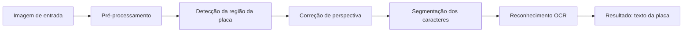
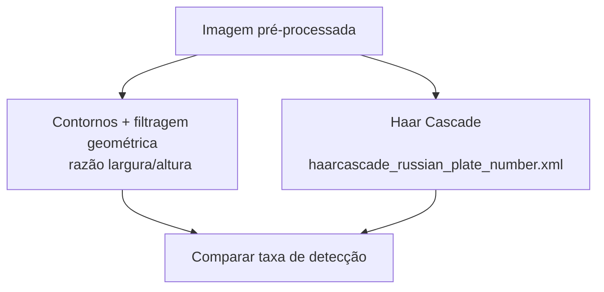
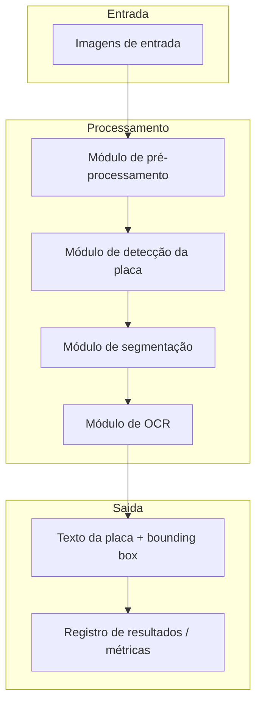

# Proposta — Detecção e Reconhecimento de Placas Veiculares (ALPR)

## Integrantes

- José Vitor da Rosa — j0se-R
- Kauã Kovalski de Campos — Kovalskiiii
- Emanuel Muller Bueno — Emanuel-Muller

## 1. Problema

O problema investigado é a **localização automática da região da placa em uma imagem de veículo e o reconhecimento dos caracteres nela contidos**.

- **Situação inicial:** uma imagem (foto ou frame de vídeo) contendo um veículo, capturada em ângulo e distância variáveis, com uma placa veicular visível.
- **Informação a ser produzida:** a região da imagem correspondente à placa (bounding box) e o texto reconhecido dos caracteres (ex: `ABC1D23`).
- **Por que envolve PDI:** a tarefa exige realce de bordas para diferenciar a placa do restante da carroceria, segmentação da região retangular da placa, correção de perspectiva (a placa raramente está perfeitamente frontal) e segmentação individual de cada caractere antes do reconhecimento.

Especificamente, o sistema deverá **detectar a posição da placa**, **corrigir sua perspectiva** e **segmentar/reconhecer os caracteres alfanuméricos**.

## 2. Contexto de aplicação

Sistemas ALPR são utilizados em controle de acesso a estacionamentos, pedágios, fiscalização de trânsito e monitoramento urbano. Este projeto pretende produzir uma versão simplificada e didática de um sistema ALPR, com contexto suficientemente concreto para avaliar os resultados: dado um conjunto de imagens de teste, é possível medir quantas placas foram corretamente localizadas e quantos caracteres foram corretamente reconhecidos.

## 3. Objetivo

**Objetivo geral:** desenvolver um pipeline de processamento de imagens capaz de localizar a placa de um veículo em uma fotografia e extrair o texto correspondente.

**Objetivos específicos:**

1. Implementar pré-processamento (escala de cinza, equalização de histograma, redução de ruído).
2. Detectar a região da placa, comparando ao menos duas abordagens (contornos + filtragem geométrica vs. Haar Cascade pré-treinada).
3. Corrigir a perspectiva da região detectada (_warp_).
4. Segmentar os caracteres individuais da placa.
5. Reconhecer os caracteres segmentados (OCR) e medir a taxa de acerto em um conjunto de teste.

## 4. Entrada e saída esperadas

```text
imagem do veículo
   ↓
pré-processamento (grayscale, blur, equalização)
   ↓
detecção da região da placa (contornos / Haar Cascade)
   ↓
correção de perspectiva
   ↓
segmentação dos caracteres
   ↓
reconhecimento (OCR)
   ↓
texto da placa
```

- **Entrada:** imagem estática (JPG/PNG) contendo um veículo com placa visível.
- **Saída:** bounding box da placa + string de texto reconhecida.
- **Decisão/informação produzida:** confirmação da localização da placa e seu conteúdo textual, permitindo posteriormente comparação com um valor esperado (ground truth) para cálculo de acurácia.

## 5. Imagens e dados

- **Origem:** dataset público **RodoSol-ALPR** ([raysonlaroca/rodosol-alpr-dataset](https://github.com/raysonlaroca/rodosol-alpr-dataset)), contendo 20.000 imagens capturadas por câmeras estáticas em praças de pedágio da concessionária Rodovia do Sol (ES-060, Espírito Santo).
- **Complementação:** fotos próprias, adicionando exemplos capturados em condições distintas das do dataset (ângulo, distância e iluminação diferentes dos pontos fixos de pedágio).
- **Quantidade inicial:** o dataset completo possui 20.000 imagens, divididas em 8.000 de treino, 8.000 de teste e 4.000 de validação; para a M1, um subconjunto reduzido (~30–50 imagens) será usado nos experimentos exploratórios iniciais.
- **Características relevantes:** inclui veículos de diferentes tipos (carros, motos, ônibus, caminhões), capturados de dia e à noite, em dias claros e chuvosos, com distância variável até a câmera. Contém dois layouts de placa: padrão brasileiro antigo e padrão Mercosul — o que atende diretamente à necessidade do projeto de cobrir o padrão atual.
- **Anotações disponíveis:** cada imagem possui um arquivo de texto associado contendo o tipo do veículo, o layout da placa (Brasileiro ou Mercosul), o texto da placa e a posição (x, y) dos quatro cantos — útil tanto para treinar/validar a detecção quanto para gerar o ground truth da correção de perspectiva.
- **Formato/resolução:** imagens no formato PNG, todas com resolução de 1.280 × 720 pixels.
- **Restrições de uso e licença:** o dataset é distribuído **apenas para fins de pesquisa acadêmica**, sem uso comercial. O acesso não é direto: é necessário preencher um acordo de licença e enviá-lo por e-mail institucional (.edu ou equivalente) ao autor responsável, que em seguida fornece o link de download.
- **Amostra usada na M2:** 26 imagens (8 carros-br, 9 motos-br, 9 motos-me), em `dataset/` localmente, sem versionamento (ver `dataset/README.md`).
- **Amostra usada na M2:** 26 imagens (8 carros-br, 9 motos-br, 9 motos-me), em `dataset/` localmente, sem versionamento (ver `dataset/README.md`).
- **Distribuição no repositório:** por se tratar de um dataset de acesso condicionado a acordo de licença e por conter placas reais, **as imagens não serão redistribuídas diretamente no repositório**. O `README.md` e este documento conterão instruções de como obter o dataset (link do repositório oficial e processo de solicitação de licença). Fotos próprias, quando usadas, serão as únicas imagens efetivamente versionadas.
- **Citação:** caso o dataset seja utilizado nos resultados do projeto, o trabalho original deverá ser citado (R. Laroca et al., _"On the Cross-dataset Generalization in License Plate Recognition"_, VISAPP, 2022).

## 6. Pipeline preliminar



Alternativas consideradas para a etapa de detecção:



|Etapa|Finalidade|Técnica considerada|Entrada|Saída|Dúvidas em aberto|
|---|---|---|---|---|---|
|Pré-processamento|Reduzir ruído e realçar bordas|Grayscale, blur gaussiano, equalização de histograma|Imagem RGB|Imagem tratada em escala de cinza|Qual nível de blur preserva bordas da placa sem perder detalhe|
|Detecção da placa|Localizar a região retangular da placa|Contornos + filtro por proporção; Haar Cascade|Imagem tratada|Bounding box da placa|Qual método generaliza melhor entre ângulos/distâncias|
|Correção de perspectiva|Alinhar a placa frontalmente|Transformação de perspectiva (warpPerspective)|Bounding box + 4 cantos|Imagem retificada da placa|Como detectar os 4 cantos de forma robusta|
|Segmentação de caracteres|Isolar cada caractere|Threshold + contornos|Placa retificada|Conjunto de sub-imagens (caracteres)|Como lidar com caracteres colados ou parafuso/moldura no meio|
|Reconhecimento (OCR)|Converter caractere em texto|Tesseract OCR|Sub-imagens de caracteres|Texto da placa|Precisão do Tesseract em fontes de placa (padrão Mercosul)|

## 7. Arquitetura preliminar



A solução será organizada em funções/módulos separados (um por etapa do pipeline), permitindo testar e comparar abordagens alternativas (ex: trocar o método de detecção) sem alterar as demais etapas.

> **Revisão M2:** a implementação passou de C++ para **Python + OpenCV**, por maior facilidade de desenvolvimento e experimentação do grupo. A API do OpenCV é equivalente, então os algoritmos e a arquitetura não mudam.

## 8. Estudo inicial de viabilidade

- Inspeção manual de amostras do dataset RodoSol-ALPR confirma que as placas ocupam uma região claramente retangular e de alto contraste em relação à carroceria, favorecendo a detecção por contornos.
- Por incluir explicitamente imagens dos padrões Brasileiro e Mercosul, o dataset elimina a necessidade de complementação extensa apenas para cobrir o padrão atual, reduzindo o risco de escassez de dados representativos.
- A Haar Cascade `haarcascade_russian_plate_number.xml`, distribuída com o próprio OpenCV, é amplamente documentada em tutoriais e artigos como ponto de partida razoável para detecção de placas, mesmo em outros países/padrões.
- Tesseract OCR é uma ferramenta madura e amplamente utilizada em projetos similares de ALPR documentados na literatura técnica e em repositórios públicos.
- Riscos identificados: variação de iluminação (imagens diurnas e noturnas), condições climáticas (dias chuvosos) e a diferença de fonte entre os padrões Brasileiro e Mercosul podem reduzir a taxa de acerto do OCR — serão tratados como limitações conhecidas a investigar durante a M2. Além disso, como o acesso ao dataset depende de aprovação por e-mail institucional, o cronograma do grupo deve considerar esse tempo de espera (1–5 dias úteis, segundo os mantenedores).

## 9. Referências

- R. Laroca, E. V. Cardoso, D. R. Lucio, V. Estevam, and D. Menotti, "On the Cross-dataset Generalization in License Plate Recognition," International Conference on Computer Vision Theory and Applications (VISAPP), 2022.
- Repositório do dataset RodoSol-ALPR: [https://github.com/raysonlaroca/rodosol-alpr-dataset](https://github.com/raysonlaroca/rodosol-alpr-dataset)
- Documentação oficial do OpenCV: [https://docs.opencv.org/](https://docs.opencv.org/)
- Documentação oficial do Tesseract OCR: [https://github.com/tesseract-ocr/tesseract](https://github.com/tesseract-ocr/tesseract)

_Seção a ser complementada com demais literatura técnica e trabalhos relacionados conforme o projeto avance._

## 10. Uso de Inteligência Artificial generativa

Para a etapa M2, foi utilizado o Claude (Anthropic), na criação da estrutura de pastas do projeto e para redigir o documento "README.md".