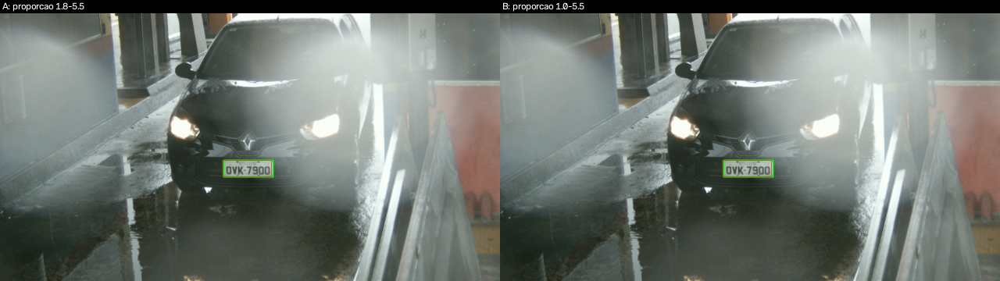

# Relatório parcial M2 — ALPR didático

## 1. Problema e objetivos atuais

Localizar a placa de um veículo em uma imagem, retificar sua perspectiva, segmentar os caracteres e reconhecer o texto (ALPR). Para a M2 o objetivo foi tornar executável e **mensurável** a parte de segmentação/morfologia/componentes, e medir de forma preliminar a detecção da placa em cena completa. Critérios de sucesso da M2: (i) fluxo entrada → saída verificável; (ii) comparação controlada entre configurações; (iii) indicador quantitativo contra a anotação do dataset.

## 2. Evolução desde a M1 e revisão da proposta

| Item (M1) | Situação na M2 | Evidência |
|---|---|---|
| Pré-processamento | Implementado (cinza, CLAHE 4×4, Gaussiano 3×3; bilateral + Sobel na detecção) | `src/pipeline.py` |
| Detecção por contornos + filtro geométrico | Implementado, avaliado por IoU; **fraco** (seção 5.1) | `results/metricas_deteccao.csv` |
| Haar Cascade | **Pendente** (M3) | — |
| Correção de perspectiva | Implementada com **cantos anotados**; estimação automática pendente | `rectify()` |
| Segmentação de caracteres | Implementada e avaliada (seção 5.2) | `results/metricas_segmentacao.csv` |
| OCR | **Pendente** (M3) | — |
| Linguagem C++ | **Substituída por Python + OpenCV**: facilidade de desenvolvimento do grupo; sem impacto nos algoritmos (mesma API OpenCV) | README |
| Dataset | Passou de "a obter" para amostra local de 26 imagens com anotação | `dataset/README.md` |

A etapa anterior desta M2 (montagem de 20 recortes sem anotação, comparação fixo × Otsu por contagem de pixels) foi preservada em `results/exploratorio_montagem/` e **não** sustenta conclusões, pois não tinha referência.

**Resposta ao feedback da M1:** *[o grupo deve colar aqui o feedback real recebido e, para cada item, a ação tomada ou a justificativa técnica. Nenhum feedback foi fornecido ao material usado para redigir este relatório.]*

## 3. Dados e protocolo experimental

- **Origem:** RodoSol-ALPR (Laroca et al., VISAPP 2022), câmeras fixas de pedágio, 1280×720, apenas pesquisa acadêmica; imagens não versionadas (`dataset/README.md`).
- **Amostra usada (26 imagens):** 8 carros (todos padrão brasileiro, `cars-br`), 9 motos brasileiro (`motocycles-br`), 9 motos Mercosul (`motocycles-me`); total 17 brasileiro e 9 Mercosul. IDs em `results/split.csv`. Há cenas com névoa/chuva, contraluz, noite e placas pequenas (motos: ~55–85 px de largura), ou seja, casos típicos e difíceis. **Limitação:** a amostra foi dada pelo grupo, não sorteada, e não há carros Mercosul (`cars-me` vazia).
- **Referência:** anotação do próprio dataset (texto da placa, layout, 4 cantos), produzida pelos autores do dataset. Limites: não há caixas/máscaras de **caracteres**; por isso a segmentação é avaliada pela **contagem** (7 caracteres) e não por IoU/Dice por caractere. A contagem correta não garante que cada componente é um caractere.
- **Ajuste × avaliação:** regra fixa e reproduzível — imagens de índice (ordem alfabética) múltiplo de 3 → **ajuste** (9); demais → **avaliação** (17). Parâmetros da segmentação foram escolhidos só no ajuste. Aviso de transparência: um teste exploratório inicial do detector (seção 5.1) foi rodado nas 26 imagens antes da divisão, e seus parâmetros **não** foram reajustados depois; por isso a detecção é reportada sobre as 26 e rotulada preliminar.

## 4. Pipeline implementado

1. **Entrada:** `dataset/*/img_*.jpg` + `.txt`.
2. **Detecção (exp. 1):** bilateral → Sobel em x (bordas verticais dos caracteres) → Otsu → fechamento 25×5 → abertura 5×3 → contornos → filtro (área ≥ 600 px², preenchimento > 0,5, proporção w/h no intervalo da configuração) → candidato de maior `área × preenchimento`.
3. **Retificação:** `getPerspectiveTransform` com os cantos anotados → 300×100 px (carros) ou 200×170 px (motos, placa de 2 linhas).
4. **Segmentação (exp. 2):** cinza → CLAHE (clip 2,0; grade 4×4) → Gaussiano 3×3 → limiarização inversa (traços escuros = primeiro plano) → abertura 2×2 → componentes conexos (8-conectividade).
5. **Filtro de caracteres:** altura entre 22% e 95% da altura da placa, largura ≤ altura, largura ≥ 2% da largura da placa, sem tocar a borda.
6. **Descritores** (`results/descritores_componentes.csv`; unidades em pixels da placa retificada): `area_px` (pixels do componente), `perimetro_px` (`arcLength` do contorno externo), `x,y,w,h` (caixa), `razao_aspecto = w/h`, `cx,cy` (centroide).

**Pendente:** estimar os cantos automaticamente, Haar Cascade, OCR.

## 5. Experimentos

Comando para ambos: `python src/pipeline.py --dataset dataset --output results`.

### 5.1 Detecção: o filtro de proporção explica a falha em motos? (preliminar)

- **Pergunta:** relaxar a proporção largura/altura de 1,8–5,5 (placa de carro) para 1,0–5,5 melhora a detecção em motos sem prejudicar carros?
- **Constante:** 26 imagens, pré-processamento, morfologia, área mínima, critério de escolha. **Muda:** só o limite inferior da proporção (A = 1,8; B = 1,0).
- **Indicador:** IoU entre a caixa escolhida (top-1) e a caixa envolvente dos cantos anotados; "detectou" = IoU ≥ 0,5.

| Config | Tipo | n | IoU médio (top-1) | Detectou (IoU ≥ 0,5) |
|---|---|---:|---:|---:|
| A (1,8–5,5) | carro | 8 | 0,55 | 75% (6/8) |
| A | moto | 18 | 0,06 | 5,6% (1/18) |
| B (1,0–5,5) | carro | 8 | 0,55 | 75% (6/8) |
| B | moto | 18 | 0,22 | 27,8% (5/18) |

**Interpretação.** Placas de moto (duas linhas, quase quadradas) são descartadas pelo filtro A; relaxá-lo eleva a detecção em motos de 1 para 5 imagens de 18 sem alterar os carros. O ganho é real mas ainda baixo: o detector global erra em cena com reflexos, e escolher o candidato por área × preenchimento não discrimina a placa de outros retângulos. Conclusão: a detecção é o **gargalo** do projeto e é a prioridade da M3.

- **Sucesso:** `img_000004` (IoU 0,91). **Falha:** `img_000002` e `img_000007` (carros, IoU 0) e a maioria das motos. Figura 4.

### 5.2 Segmentação: limiar fixo × Otsu × adaptativo

- **Pergunta:** um limiar adaptativo local segmenta melhor os caracteres que um limiar global (fixo 120 ou Otsu) quando a iluminação não é uniforme?
- **Entrada:** placas retificadas pelos cantos anotados (isola a segmentação do erro de detecção).
- **Constante:** pré-processamento, abertura 2×2, filtro de caracteres, imagens. **Muda:** só a binarização (fixo T=120; Otsu; adaptativo Gaussiano, janela 31, C=10).
- **Indicador:** erro absoluto de contagem |detectados − 7| e acerto exato (detectados = 7).
- **Ajuste dos parâmetros** (só nas 9 imagens de ajuste): testados `h_min` ∈ {0,15; 0,22; 0,30} e abertura ∈ {1,2,3}; adotados os valores centrais (0,22 e 2×2). C=14 do adaptativo reduziu o erro no ajuste, mas **não foi adotado** (9 imagens são pouco para escolher esse refinamento).

**Resultado na avaliação (17 imagens):**

| Config | Erro abs. médio | Acerto exato | Subcontagem | Sobrecontagem |
|---|---:|---:|---:|---:|
| Fixo (120) | 1,53 | 10/17 (59%) | 7 | 0 |
| Otsu | 1,47 | 9/17 (53%) | 8 | 0 |
| **Adaptativo** | **0,41** | **11/17 (65%)** | 3 | 3 |

Por tipo (26 imagens): nos 8 carros os três métodos acertam 100%; nas 18 motos, erro médio fixo 2,22, Otsu 2,06, adaptativo 0,78 (acerto 33%, 33%, 50%). Ajuste (9): erro 1,56 / 1,33 / 0,78.

**Interpretação.** Em carros a placa é grande e de contraste suficiente: o método de limiarização é irrelevante. Em motos, caracteres pequenos e iluminação irregular fazem os limiares globais **perder** caracteres (só subcontagem), enquanto o adaptativo recupera a maioria, ao custo de começar a sobrecontar (ruído, parafusos, borda). A vantagem do adaptativo em motos é consistente nas três visões (ajuste, avaliação, total), mas **17 imagens não sustentam generalização**. Acerto exato por contagem é indicador fraco: `img_017502` tem 8 componentes nos três métodos (sobra um ruído) e conta como erro, mas um 7 pode ocultar um erro que se compensa.

## 6. Referência de avaliação e métricas futuras

Para M3: anotar caixas de caracteres em um subconjunto (revisadas por um segundo integrante) para calcular IoU/Dice por caractere; OCR avaliado por placa exata e erro por caractere (o `.txt` já traz o texto). Manter a divisão ajuste/avaliação e ampliar a amostra.

## 7. Falhas, limitações e riscos

- Retificação usa **cantos anotados**: os resultados de segmentação são um limite superior do que o pipeline completo alcança hoje.
- Detecção fraca em motos e em cenas com reflexo/névoa; só 26 imagens (sem carros Mercosul).
- Contagem de componentes ≠ qualidade por caractere; letras podem se tocar, se quebrar, ou ruído pode virar "caractere".
- Filtros de caractere (altura, largura, borda) foram ajustados com poucas imagens e podem não servir para placas de outras cores (ex.: fundo escuro).
- Licença do dataset: pesquisa acadêmica; imagens não versionadas. Figuras do relatório mostram placas reais; o grupo deve confirmar que isso é permitido.

## 8. Plano de conclusão para M3

| Tarefa | Responsável | Evidência esperada |
|---|---|---|
| Estimar cantos da placa automaticamente (contornos/`minAreaRect`) e retificar sem oráculo | *a definir* | IoU dos cantos; imagens antes/depois |
| Melhorar escolha do candidato e comparar com Haar Cascade | *a definir* | Tabela IoU/taxa de detecção; falhas |
| Segmentação específica para placas de 2 linhas (moto) | *a definir* | Erro de contagem em motos |
| Anotar caixas de caracteres (subconjunto) | *a definir* | CSV de anotações + revisão cruzada |
| OCR (Tesseract) e avaliação | *a definir* | Placa exata e erro por caractere |
| Ampliar amostra (incluindo carros Mercosul) | *a definir* | `split.csv` atualizado |
| Atualizar relatório, README e vídeo | *a definir* | Vídeo não listado ~10 min |

## 9. Contribuições dos integrantes

| Integrante | Contribuição efetiva | Evidência |
|---|---|---|
| José Vitor da Rosa | *a preencher pelo grupo* | arquivo/experimento/revisão |
| Kauã Kovalski de Campos | *a preencher pelo grupo* | arquivo/experimento/revisão |
| Emanuel Muller Bueno | *a preencher pelo grupo* | arquivo/experimento/revisão |

## 10. Uso de IA generativa

Para a etapa M2, foi utilizado o Claude (Anthropic), na criação da estrutura de pastas do projeto e para redigir o documento "README.md".

## Referências

- Laroca, R.; Cardoso, E. V.; Lucio, D. R.; Estevam, V.; Menotti, D. “On the Cross-dataset Generalization in License Plate Recognition.” VISAPP, 2022.
- RodoSol-ALPR: https://github.com/raysonlaroca/rodosol-alpr-dataset
- OpenCV: https://docs.opencv.org/ · Tesseract OCR: https://github.com/tesseract-ocr/tesseract
